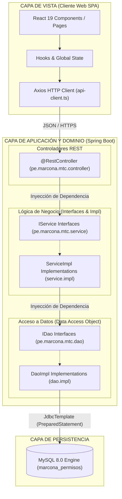
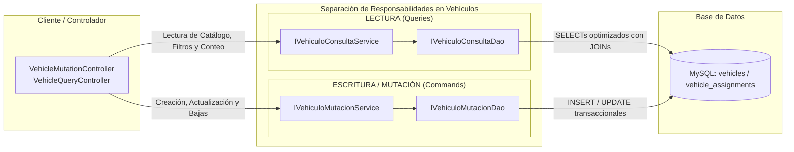

# Arquitectura del Sistema y Patrones de Diseño
### Estándares de Ingeniería de Software para TRANSIGOVAI

Este documento detalla los fundamentos arquitectónicos, patrones estructurales y directrices de diseño implementados en **TRANSIGOVAI**, garantizando desacoplamiento, alta cohesión, facilidad de prueba (testability) y extensibilidad a largo plazo.

---

## 1. El Paradigma MVC Moderno y Desacoplado

El sistema implementa una variante moderna del patrón **Modelo-Vista-Controlador (MVC)**, donde la **Vista** ha sido completamente externalizada hacia un cliente SPA (Single Page Application) enriquecido en React, mientras que el **Controlador** y el **Modelo** residen en una API REST construida sobre Spring Boot.



### Flujo de Interacción:
1. **La Vista (React):** Captura interacciones del usuario, gestiona el estado local y despacha peticiones asíncronas vía HTTP hacia endpoints REST estándar (`/api/*`). No contiene reglas de negocio ni lógica de persistencia.
2. **El Controlador (`@RestController`):** Recibe las solicitudes HTTP, aplica validaciones iniciales de estructura (cuerpo JSON, cabeceras, tokens), y delega inmediatamente el trabajo a la capa de servicio. **Nunca accede directamente a la base de datos**.
3. **El Modelo (Servicio + DAO):**
   * **Capa de Servicio:** Orquesta las reglas de negocio, validaciones complejas, transacciones (`@Transactional`), cálculos de vigencia y autorizaciones.
   * **Capa DAO (Data Access Object):** Encapsula todas las sentencias SQL parametrizadas, mapeando los resultados relacionales a estructuras de dominio seguras.

---

## 2. Inversión de Dependencias (DIP) y Principios SOLID

El pilar fundamental de la refactorización Enterprise de TRANSIGOVAI es el cumplimiento riguroso de los principios **SOLID**, destacando la **Inversión de Dependencias (Dependency Inversion Principle - DIP)** y la **Segregación de Responsabilidades (Single Responsibility Principle - SRP)**.

### Inversión de Dependencias en la Práctica
Ninguna clase de alto nivel depende de implementaciones concretas; todas las dependencias se declaran contra **interfaces puras**:

```java
// Controladores dependen exclusivamente de la interfaz de servicio
@RestController
@RequestMapping("/api/usuarios")
public class UsersController {

    private final IUsuarioService usuarioService;

    // Inyección por constructor (Inversión de Control estricta)
    public UsersController(IUsuarioService usuarioService) {
        this.usuarioService = Preconditions.checkNotNull(usuarioService);
    }
}
```

```java
// Los servicios dependen exclusivamente de la interfaz del DAO
@Service
public class UsuarioServiceImpl implements IUsuarioService {

    private final IUsuarioDao usuarioDao;
    private final BCryptPasswordEncoder passwordEncoder;

    public UsuarioServiceImpl(IUsuarioDao usuarioDao) {
        this.usuarioDao = Preconditions.checkNotNull(usuarioDao);
        this.passwordEncoder = new BCryptPasswordEncoder(12);
    }
}
```

### Ventajas de este Diseño:
* **Desacoplamiento Total:** La capa de servicios desconoce si el DAO almacena datos en MySQL, PostgreSQL o una base de datos en memoria.
* **Testabilidad Absoluta:** Permite escribir pruebas unitarias utilizando dobles de prueba (`Mockito.mock(IUsuarioDao.class)`), aislando el código bajo prueba sin necesidad de levantar bases de datos reales.
* **Sustitución de Liskov (LSP):** Cualquier implementación que respete el contrato de `IUsuarioService` puede reemplazar a `UsuarioServiceImpl` sin alterar el comportamiento de los controladores.

---

## 3. Segregación de Responsabilidades (SRP)

En versiones anteriores, existían clases con responsabilidades mezcladas (como la gestión conjunta de empresas y conductores en un único servicio). La arquitectura actual aplica SRP dividiendo los flujos en dominios independientes:

| Dominio Original Acoplado | Segregación Aplicada | Propósito Único |
|---|---|---|
| `CompanyDriverService` | `IEmpresaService` + `IEmpresaDao` | Gestión exclusiva de personas jurídicas, RUC y licencias de empresa |
| `CompanyDriverService` | `IConductorService` + `IConductorDao` | Registro de personas naturales, licencias MTC y récords de conductor |
| `TokenService` / `Auth` | `IAutenticacionService` | Validación de credenciales, login y ciclo de vida de sesiones |
| `TokenService` / `Auth` | `ITokenLegadoService` | Deserialización y compatibilidad hacia atrás con tokens JWT del sistema previo |

---

## 4. Patrón CQRS Básico en el Dominio de Vehículos

El dominio vehicular representaba uno de los puntos con mayor volumen transaccional y complejidad de consulta. Para optimizar el rendimiento y clarificar las responsabilidades del código, se implementó el patrón **CQRS (Command Query Responsibility Segregation)** a nivel de servicios:



### 1. `IVehiculoConsultaService` (Capa de Lectura / Queries)
* **Responsabilidad:** Exclusivamente operaciones de consulta, búsqueda por placa, filtros por empresa, conteo estadístico y paginación.
* **Garantía:** Métodos con semántica de sólo lectura (`obtenerPorId`, `buscarPorPlaca`, `listarTodos`), sin efectos secundarios (side effects) sobre el estado de la base de datos.

### 2. `IVehiculoMutacionService` (Capa de Escritura / Commands)
* **Responsabilidad:** Ejecución de comandos que alteran el estado del sistema: creación de unidades vehiculares, actualización de características técnicas (año de fabricación, motor, chasis), desactivaciones y cambio de estado administrativo.
* **Garantía:** Operaciones transaccionales y fuertemente auditadas con validaciones de unicidad de placa y vigencia de SOAT.

---

## 5. Convención de "Spanglish Arquitectónico"

El proyecto adopta formalmente la convención de **Spanglish Arquitectónico**, diseñada para equilibrar las mejores prácticas globales del ecosistema de software con la realidad legal y administrativa peruana:

```text
pe.marcona.mtc.
├── controller/            <-- Estructura de Framework en INGLÉS
│   └── UsersController.java
├── service/               <-- Estructura de Framework en INGLÉS
│   ├── IUsuarioService.java         <-- Dominio de Negocio en ESPAÑOL
│   └── impl/
│       └── UsuarioServiceImpl.java  <-- Dominio de Negocio en ESPAÑOL
├── dao/                   <-- Estructura de Framework en INGLÉS
│   ├── IUsuarioDao.java             <-- Dominio de Negocio en ESPAÑOL
│   └── impl/
│       └── UsuarioDaoImpl.java      <-- Dominio de Negocio en ESPAÑOL
└── dto/                   <-- Estructura de Framework en INGLÉS
    └── ApiResponse.java
```

### Reglas Claras de Nomenclatura:
1. **Paquetes y Anotaciones del Framework (Inglés):**
   * Nombres de carpetas y paquetes de Spring Boot: `controller`, `service`, `dao`, `dto`, `config`, `exception`.
   * Anotaciones estándar: `@RestController`, `@Service`, `@Repository`, `@Transactional`.
2. **Entidades, Clases, Interfaces y Métodos de Negocio (Español):**
   * Prefijo `I` para contratos de interfaz: `IUsuarioService`, `IPermisoDao`, `IVehiculoConsultaService`.
   * Sufijo `Impl` para clases de implementación en subcarpeta `impl/`: `UsuarioServiceImpl`, `PermisoDaoImpl`.
   * Verbos y variables de negocio en español formal: `crearUsuario()`, `obtenerPorId()`, `actualizarPermiso()`, `numeroPlaca`, `fechaVigencia`.
   * Nombres de tablas y columnas de base de datos en español/estándar existente: `users`, `vehicles`, `permisos`, `action_logs`.
